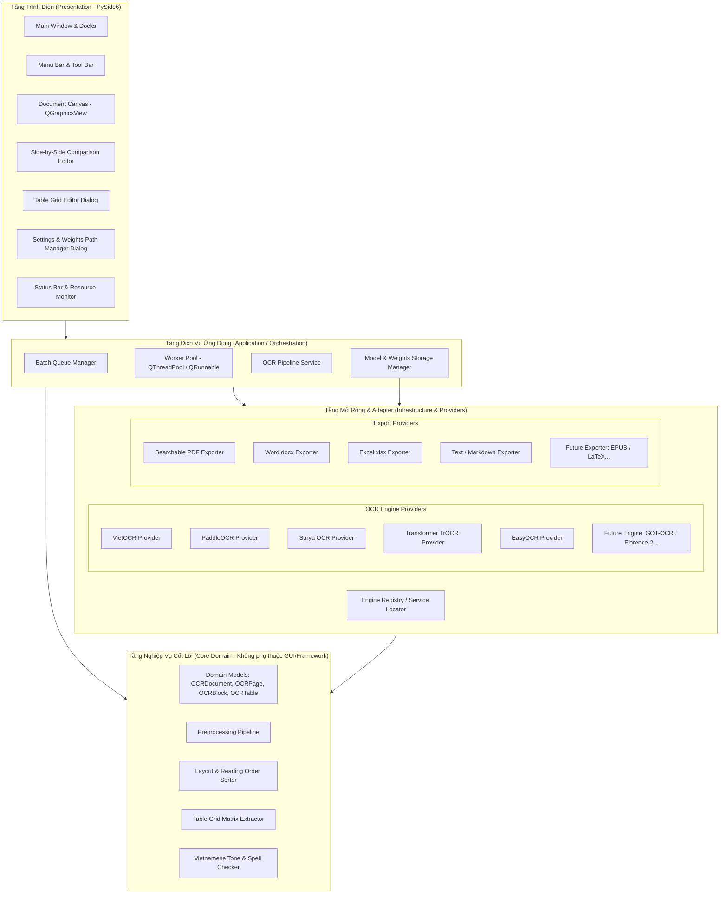

# Tài Liệu Đặc Tả & Kế Hoạch Triển Khai Kỹ Thuật (Spec & Implementation Plan)
## Ứng Dụng Desktop OCR Đa Mô Hình, Bảo Toàn Bố Cục & Chuyển Đổi Tài Liệu (PySide6)

> **Tuân thủ chuẩn mực kỹ thuật:**  
> - [x] **Spec-Driven Development** (Gated Workflow, 6 Core Areas, Boundaries, Success Criteria)  
> - [x] **Test-Driven Development (TDD)** (Red-Green-Refactor, Test Pyramid, Small/Medium Test Isolation)  
> - [x] **Code Review & Quality Gate** (5-Axis Review: Correctness, Readability, Architecture, Security, Performance)  
> - [x] **Kiến Trúc Mở Rộng Chuyên Nghiệp (Clean & Extensible Architecture)** (Plugin/Provider Pattern, Dependency Injection, Service Registry)  
> - [x] **Quản Lý Model & Weights Tùy Chỉnh (Custom Weights Directory Management)**

---

## 1. Mục Tiêu Dự Án (Objective)

### 1.1. Tuyên Bố Bài Toán (Problem Statement)
Người dùng cần chuyển đổi tài liệu số hóa (PDF scan, hình ảnh chụp từ điện thoại, văn bản hỗn hợp) **và cả PDF text-based** (PDF đã có text layer sẵn) sang các định dạng văn bản có thể chỉnh sửa (`.docx`, `.xlsx`, Searchable `.pdf`, `.txt`, `.md`, `.json`) nhưng các công cụ thông thường gặp các hạn chế nghiêm trọng:
- **Không phân biệt PDF scanned và text-based:** Chạy OCR trên PDF đã có text layer sẵn là thừa, chậm và có thể kém chính xác hơn so với trích xuất text trực tiếp.
- Mất bố cục nhiều cột (cột báo, tạp chí bị nối ngang dòng).
- Tiếng Việt bị lỗi dấu thanh hoặc sai ký tự đặc thù (`ở`, `ẵ`, `ệ`, `ỳ`, `đ`).
- Không đọc được chữ viết tay (handwritten notes, mẫu đơn điền tay).
- Không tự động làm sạch được các vết nhòe, nhiễu scan, nghiêng lệch góc.
- Bảng biểu bị phân mảnh thành text rời rạc thay vì ô lưới Excel/Word.
- Không có môi trường trực quan để so sánh song song ảnh gốc với text nhận diện nhằm soát và sửa lỗi chính tả nhanh chóng.
- **Vấn đề lưu trữ model weights:** Các ứng dụng AI thường tải weights vào thư mục ẩn người dùng (`~/.cache`, `%USERPROFILE%/.cache`), dễ làm đầy ổ `C:` hệ điều hành, khó sao chép sang máy offline và không cho phép người dùng tùy chọn lưu trữ trên ổ đĩa dữ liệu dung lượng lớn (ví dụ: ổ `D:`, ổ cứng di động).
- **Khả năng mở rộng:** Khó bổ sung thêm các mô hình AI mới ra đời nếu mã nguồn bị gắn chặt (tightly coupled).

### 1.2. Mục Tiêu Xây Dựng (Core Objectives)
Phát triển ứng dụng Desktop hoàn chỉnh bằng **PySide6 (Qt 6)** đáp ứng:
1. **Kiến Trúc Mở Rộng Plugin/Provider (Extensible Enterprise Architecture):**
   - Áp dụng nguyên lý SOLID (đặc biệt là Open-Closed Principle). Tách rời lõi nghiệp vụ (Domain/Core) khỏi các thư viện bên thứ 3.
   - Thêm một mô hình OCR mới (như GOT-OCR 2.0, Florence-2, Tesseract) hoặc một định dạng xuất mới (như LaTeX, EPUB, ALTO XML) chỉ cần thêm một Provider class mới mà **không cần sửa đổi mã nguồn cốt lõi**.
2. **Quản Lý Model & Weights Tập Trung, Tùy Chỉnh Linh Hoạt:**
   - Hỗ trợ thiết lập đường dẫn lưu trữ weights tùy chỉnh (Custom Directory) qua giao diện Cài đặt.
   - Mặc định là thư mục `src/models/` nằm trong thư mục mã nguồn ứng dụng, cho phép ứng dụng hoạt động dạng Portable hoặc chạy trong mạng nội bộ.
   - Tự động chuyển hướng (redirect) toàn bộ biến môi trường cache của PyTorch (`TORCH_HOME`), HuggingFace (`HF_HOME`, `HUGGINGFACE_HUB_CACHE`), PaddleOCR (`PADDLE_HOME`), EasyOCR (`EASYOCR_MODULE_PATH`) về thư mục này.
3. **Xử Lý Thông Minh PDF Text-based & Scanned:**
   - Tự động phân loại từng trang PDF: scanned (chỉ có ảnh), text-based (có text layer sẵn), hoặc hybrid (hỗn hợp cả hai).
   - Với trang text-based: trích xuất text, tọa độ, font trực tiếp từ PDF text layer bằng PyMuPDF (`page.get_text("dict")`) — nhanh gấp 10-50 lần, chính xác 100%.
   - Với trang scanned: đi qua pipeline OCR đầy đủ.
   - Với trang hybrid: ưu tiên text layer, OCR fallback cho vùng không có text.
4. **Module OCR Đa Dạng (Strategy Pattern):** Hỗ trợ chuyển đổi giữa **PaddleOCR**, **Surya OCR**, **VietOCR**, **Transformer OCR (TrOCR)**, và **EasyOCR**. Cho phép tinh chỉnh siêu tham số và thiết bị (`cpu` / `cuda`) cho từng model.
5. **Tiền Xử Lý Ảnh Thông Minh:** Tự động xoay thẳng 4 chiều (0/90/180/270°), tự làm thẳng độ nghiêng (-45° đến +45°), khử nhiễu, cân bằng sáng và loại bỏ bóng đổ/gáy sách.
6. **Bảo Toàn Cấu Trúc & Bố Cục:** Tách khối văn bản (Heading, Paragraph, Table, Figure), bảo toàn thứ tự đọc tự nhiên đa cột (Reading Order).
7. **Nhận Diện Chữ Viết Tay & Tiếng Việt Chuẩn:** Tích hợp VietOCR cho tiếng Việt dấu thanh chuẩn và TrOCR cho chữ viết tay.
8. **Bộ So Sánh Lỗi Song Song ("Side-by-Side Verification Editor"):** Canvas hiển thị ảnh gốc đồng bộ hai chiều với Text Editor, highlight từ có độ tin cậy thấp (<80%), hỗ trợ Find & Replace sửa lỗi hàng loạt, và bộ sửa bảng lưới tương tác.
9. **Xuất File Đa Định Dạng:**
   - Searchable PDF (Ctrl + F) với invisible text layer chuẩn tọa độ pixel.
   - Word (`.docx`) giữ nguyên heading, căn lề và bảng biểu.
   - Excel (`.xlsx`) trích xuất bảng nguyên vẹn hàng và cột.
   - Markdown (`.md`) và Plain Text (`.txt`).
10. **Quét Hàng Loạt (Batch Processing):** Hàng đợi xử lý bất đồng bộ đa luồng (`QThreadPool`), xử lý hàng trăm trang mượt mà không khóa giao diện (Zero UI Freeze).
11. **Trải Nghiệm Desktop Chuyên Nghiệp (Professional Desktop UX):**
    - Kéo thả file (Drag & Drop) từ File Explorer vào ứng dụng.
    - Danh sách file đã mở gần đây (Recent Files).
    - Undo/Redo trong trình soạn thảo Bộ so sánh lỗi.
    - Lưu và phục hồi trạng thái cửa sổ (Window State Persistence).
    - Chọn vùng OCR trên ảnh (Region Selection) thay vì OCR toàn bộ trang.
12. **Đóng Gói Ứng Dụng Di Động (Portable Distribution & Packaging):**
    - Hỗ trợ đóng gói ứng dụng độc lập bằng **PyInstaller** (chế độ Onedir - thư mục phân phối độc lập).
    - Chạy dạng **Portable 100% Offline**: sao chép cả thư mục ứng dụng sang máy khác (không cần cài đặt Python hay thư viện) là có thể chạy ngay.
    - **Tự động nhận diện thư mục `src/models/` đi kèm:** Khi mang theo thư mục weights, ứng dụng tự động nhận diện weights cục bộ, tuyệt đối không gọi mạng hay cố tải weights về ổ `C:` trên máy mới.

### 1.3. Ngăn Xếp Công Nghệ (Tech Stack)
| Thành Phần | Thư Viện / Framework | Phiên Bản Tối Thiểu |
| :--- | :--- | :--- |
| **Ngôn ngữ** | Python | ≥ 3.10 |
| **GUI Framework** | PySide6 (Qt 6) | ≥ 6.6 |
| **PDF Engine** | PyMuPDF (fitz) | ≥ 1.24 |
| **OCR - Tiếng Việt** | VietOCR | ≥ 0.3.12 |
| **OCR - Đa năng** | PaddleOCR | ≥ 2.7 |
| **OCR - Layout** | surya-ocr | ≥ 0.5 |
| **OCR - Chữ viết tay** | transformers (TrOCR) | ≥ 4.40 |
| **OCR - Dự phòng** | EasyOCR | ≥ 1.7 |
| **Computer Vision** | opencv-python | ≥ 4.9 |
| **Xuất Word** | python-docx | ≥ 1.1 |
| **Xuất Excel** | openpyxl | ≥ 3.1 |
| **Xử lý ảnh** | Pillow | ≥ 10.0 |
| **Deep Learning** | PyTorch | ≥ 2.1 |
| **Logging** | Loguru | ≥ 0.7 |
| **Đóng gói Portable** | PyInstaller | ≥ 6.0 |

### 1.4. Các Lệnh Chính (Commands)
```bash
# Cài đặt
pip install -e .                                    # Cài đặt ứng dụng ở chế độ dev
pip install -r requirements-dev.txt                 # Cài đặt thêm thư viện dev/test

# Chạy ứng dụng
python -m src.main                                  # Khởi chạy ứng dụng Desktop

# Kiểm thử
pytest tests/ --cov=src --cov-report=term-missing   # Chạy toàn bộ test + coverage
pytest -m unit                                      # Chỉ chạy unit tests
pytest -m integration                               # Chỉ chạy integration tests
pytest -m gui                                       # Chỉ chạy GUI tests

# Linting & Formatting
black src/ tests/                                   # Auto-format code
isort src/ tests/                                   # Sắp xếp import
ruff check src/                                     # Lint kiểm tra lỗi tĩnh
mypy src/                                           # Type checking

# Bảo mật
bandit -r src/                                      # Quét lỗ hổng bảo mật tĩnh

# Đóng gói Portable (Phân phối sang máy khác)
pyinstaller packaging/pdf-ocr.spec                  # Đóng gói ra dist/pdf-ocr/
python packaging/build_portable.py                 # Tự động đóng gói & nén zip Portable
```

---

## 2. Kiến Trúc Hệ Thống & Thiết Kế Mở Rộng (Architecture & Extensibility)

### 2.1. Sơ Đồ Khối Tầng Kiến Trúc (Layered Clean Architecture)



### 2.2. Cơ Chế Quản Lý Model & Weights Tùy Chỉnh (Weights Storage Manager)
Để đảm bảo tính linh hoạt, ứng dụng tách rời việc quản lý file nhị phân weights khỏi code:
1. **Thư mục mặc định:** `<app_root>/src/models/` (ví dụ: `d:\GitHub\pdf-ocr\src\models\`).
   - Cấu trúc thư mục con rõ ràng:
     ```
     src/models/
     ├── vietocr/         # Trọng số VGG-Transformer, CRNN
     ├── paddle/          # Trọng số PP-OCRv4 detection, recognition, PP-Structure
     ├── surya/           # Trọng số Surya detection, recognition, order
     ├── trocr/           # HuggingFace checkpoint TrOCR printed & handwritten
     └── easyocr/         # Trọng số PyTorch EasyOCR CRAFT & CRNN
     ```
2. **Tùy chỉnh thư mục qua UI (Custom Weights Directory):**
   - Trong giao diện Cài đặt (Settings), người dùng có thể nhấp **"Duyệt..." (Browse)** để trỏ tới bất kỳ thư mục nào (ví dụ: `E:\AI_Models\pdf-ocr_weights`).
   - Có nút **"Di chuyển weights hiện tại" (Move Existing Weights)** để chuyển tự động các model đã tải sang vị trí mới.
   - Có chỉ báo dung lượng ổ đĩa còn trống (Free Disk Space) giúp người dùng biết ổ cứng có đủ chỗ trước khi tải weights nặng.
3. **Cơ chế Hook chuyển hướng môi trường (Environment Redirection Hook):**
   - Khi khởi động ứng dụng hoặc khi người dùng đổi thư mục weights, `ModelWeightsManager` sẽ tự động thiết lập các biến môi trường trước khi bất kỳ thư viện deep learning nào được nạp:
     ```python
     os.environ["TORCH_HOME"] = os.path.join(weights_dir, "torch")
     os.environ["HF_HOME"] = os.path.join(weights_dir, "huggingface")
     os.environ["HUGGINGFACE_HUB_CACHE"] = os.path.join(weights_dir, "huggingface", "hub")
     os.environ["PADDLE_HOME"] = os.path.join(weights_dir, "paddle")
     os.environ["EASYOCR_MODULE_PATH"] = os.path.join(weights_dir, "easyocr")
     ```
   - Nhờ vậy, 100% các file weights tải về đều tự động nằm trong thư mục người dùng đã chỉ định, không bao giờ tự ý ghi vào ổ `C:` hay thư mục ẩn hệ thống.
4. **Tương thích đóng gói Portable & Chạy Offline trên máy khác (`sys.frozen` Detection):**
   - Khi chạy dạng file thực thi đóng gói (`pdf-ocr.exe`), PyInstaller thiết lập `sys.frozen = True`. `ModelWeightsManager` tự động nhận biết:
     - Nếu `sys.frozen`: lấy gốc ứng dụng từ `Path(sys.executable).parent`.
     - Nếu chạy mã nguồn Python: lấy gốc từ `Path(__file__).resolve().parent.parent`.
   - **Khả năng mang sang máy khác (Portable Out-of-the-Box):** Khi người dùng copy toàn bộ thư mục bundle (chứa `pdf-ocr.exe` và thư mục `src/models/` hoặc `models/` đã tải weights) sang một máy tính hoàn toàn mới:
     - Không cần cài Python, không cần cài thư viện.
     - Ứng dụng tự động tìm thấy weights đi kèm trong bundle và kích hoạt ngay lập tức.
     - Chạy 100% Offline, không phát sinh bất kỳ kết nối mạng nào để tải model.

### 2.3. Khả Năng Mở Rộng Plugin/Provider (Open-Closed Extensibility)
- Mọi mô hình OCR mới đều kế thừa `BaseOCREngine` và đăng ký với `EngineRegistry` bằng decorator:
  ```python
  @register_engine(
      engine_id="trocr_handwritten",
      name="TrOCR Handwriting (Microsoft)",
      description="Chuyên trị chữ viết tay tiếng Anh & tiếng Việt",
      supports_handwriting=True,
      supports_tables=False
  )
  class TrOCREngine(BaseOCREngine):
      ...
  ```
- Tương tự, mọi định dạng xuất mới kế thừa `BaseExporter` và đăng ký với `ExporterRegistry`. Khi thêm một định dạng mới, giao diện người dùng (Menu Xuất, Hộp thoại Xuất) sẽ tự động hiển thị tùy chọn mới mà không cần code lại UI!

---

## 3. Phân Rã Các Module Chức Năng Chi Tiết (Detailed Functional Modules)

### 3.1. Module Quản Lý Weights & Cấu Hình (`ModelWeightsManager`)
- Kiểm tra tính hợp lệ và quyền ghi (write permission) của thư mục lưu weights.
- Tự động tạo cây thư mục con chuẩn cho từng loại model.
- Cung cấp trạng thái tải của từng model: `NOT_DOWNLOADED`, `DOWNLOADING`, `READY`, `CORRUPTED`.
- Kiểm tra tính toàn vẹn của file weights qua mã băm SHA256 trước khi tải vào RAM/VRAM.

### 3.2. Module Tải & Phân Loại Tự Động PDF (Smart Document Loader & PDF Classifier)
1. **Phân loại thông minh từng trang PDF:**
   - Sử dụng PyMuPDF phân tích từng trang: đếm số lượng ký tự text layer, số lượng ảnh nhúng, diện tích vùng ảnh.
   - Phân loại: **TEXT_BASED** (có text layer đầy đủ → trích xuất trực tiếp), **SCANNED** (chỉ có ảnh → cần OCR), **HYBRID** (có cả text lẫn vùng ảnh → ưu tiên text layer, OCR fallback).
2. **Trích xuất trực tiếp từ PDF text-based:**
   - Sử dụng `page.get_text("dict")` trích xuất text, tọa độ bounding box, font name, font size từ text layer.
   - Chuyển đổi kết quả sang chuẩn `OCRPage` / `OCRBlock` / `OCRLine` cùng định dạng với output OCR để tầng xuất file nhận cùng một kiểu dữ liệu đầu vào.
   - Tốc độ xử lý: < 1 giây/trang (so với 5-30 giây/trang khi OCR).

### 3.3. Module Tiền Xử Lý Ảnh Tự Động (Image Enhancement & Preprocessing)
1. **Tự xoay thẳng hình (Auto Deskew & Orientation Correction):**
   - **Xác định hướng trang (0°, 90°, 180°, 270°):** Sử dụng PaddleOCR Angle Classifier hoặc Tesseract OSD / Surya Orientation để tự động xoay trang về hướng chuẩn đọc từ trên xuống dưới.
   - **Chỉnh độ nghiêng tinh tế (Fine Deskew từ -45° đến +45°):** Sử dụng biến đổi Hough Line Transform (`cv2.HoughLinesP`) hoặc phân tích góc `minAreaRect` trên tập hợp các bounding box để tính góc lệch chính xác đến 0.1 độ, tự động làm thẳng trang giấy.
2. **Khử nhiễu & Làm sạch nền (Denoising & Background Cleanup):**
   - Áp dụng Fast Non-Local Means Denoising (`cv2.fastNlMeansDenoising`) kết hợp Bilateral Filter nhằm khử nhiễu hạt muối tiêu mà không làm mờ nét chữ.
3. **Cân bằng ánh sáng & Xóa vết bóng (Illumination Equalization & Shadow Removal):**
   - Ước lượng ánh sáng nền bằng toán tử hình thái học (Morphological Closing với kernel lớn) và phép chia ảnh (`cv2.divide`), triệt tiêu bóng đổ ở gáy sách hoặc góc tài liệu chụp bằng điện thoại.
4. **Tăng cường tương phản & Khử mờ (Contrast Enhancement & Sharpening):**
   - Áp dụng CLAHE (Contrast Limited Adaptive Histogram Equalization) trên kênh L của không gian màu LAB.
   - Unsharp Masking kernel để tăng độ sắc nét cạnh chữ bị nhòe mực.
5. **Cắt biên tự động (Auto Margin & Border Cropping):**
   - Nhận diện viền đen do máy quét (scanner black borders) bằng contour detection và tự động cắt bỏ.

### 3.4. Module Phân Tích Bố Cục & Trích Xuất Bảng Biểu (Layout & Table Extraction)
1. **Phân đoạn khối tài liệu (Block Segmentation):**
   - Phân loại chính xác từng vùng trên trang: Tiêu đề (Heading 1/2/3), Đoạn văn bản (Paragraph), Chú thích (Caption), Hình ảnh/Biểu đồ (Figure), Bảng biểu (Table).
2. **Xử lý văn bản nhiều cột (Multi-Column Reading Order Sorting):**
   - Xây dựng thuật toán sắp xếp thứ tự đọc tự nhiên (Topological / XY-Cut sorting).
   - Ngăn chặn triệt để lỗi đọc xuyên cột (đọc dòng từ cột 1 nối liền sang cột 2) vốn là lỗi thường gặp ở các phần mềm OCR thông thường.
3. **Nhận diện & Trích xuất bảng biểu (Table Structure Recognition):**
   - Sử dụng mô hình nhận diện bảng (PP-Structure Table Rec / Surya Table) để tách cấu trúc dòng (rows), cột (columns), ô gộp (merged cells/spans).
   - Ánh xạ trực tiếp tọa độ text vào ma trận ô 2D để chuẩn bị xuất sang định dạng bảng tính.

### 3.5. Module OCR Đa Mô Hình (Modular OCR Engine System)
| Mô Hình | Điểm Mạnh Nổi Bật | Trường Hợp Sử Dụng Tối Ưu | Tham Số Cấu Hình Đầu Vào Tùy Chọn |
| :--- | :--- | :--- | :--- |
| **VietOCR** | Chuyên sâu tiếng Việt (VGG-Transformer / CRNN), độ chính xác dấu thanh và âm điệu đạt >97%. | Tài liệu tiếng Việt chữ in, văn bản pháp lý, hành chính. | `model_name` (vgg_transformer, vgg_seq2seq), `device` (cpu/cuda), `beam_width`. |
| **PaddleOCR** | Tốc độ cực nhanh, hỗ trợ đầy đủ nhận diện bố cục và cấu trúc bảng (PP-StructureV2/V4). | Tài liệu nhiều bảng biểu, hóa đơn, báo cáo tài chính. | `det_db_thresh`, `det_db_box_thresh`, `use_angle_cls`, `lang` (vi, en, ch...), `rec_batch_num`. |
| **Surya OCR** | Nhận diện dòng text và thứ tự đọc cực kỳ chính xác trên tài liệu phức tạp, 90+ ngôn ngữ. | Sách, tạp chí học thuật nhiều cột, văn bản song ngữ. | `langs`, `batch_size`, `detect_boxes`, `reading_order`. |
| **Transformer OCR (TrOCR)** | Kiến trúc Vision-Encoder-Decoder (BEiT + RoBERTa), hiểu ngữ cảnh sâu. | **Nhận diện chữ viết tay (Handwritten)**, ghi chú, đơn điền tay. | `model_checkpoint` (handwritten/printed), `max_length`, `device`. |
| **EasyOCR** | Gọn nhẹ, dựa trên PyTorch, hỗ trợ đa ngôn ngữ nhanh chóng không cần cấu hình phức tạp. | Dự phòng (fallback), xử lý nhanh trên môi trường CPU. | `languages`, `gpu` (bool), `quantize`, `contrast_ths`, `adjust_contrast`. |

### 3.6. Module Hậu Xử Lý Tiếng Việt (Post-Processing & Diacritic Normalization)
1. **Chuẩn hóa Unicode tiếng Việt:** Chuyển đổi toàn bộ văn bản về chuẩn Unicode dựng sẵn (NFC), đồng nhất vị trí đặt dấu thanh.
2. **Sửa lỗi chính tả & nhầm lẫn ký tự OCR:** Bộ quy tắc ngữ pháp và từ điển âm tiết tiếng Việt khắc phục nhầm lẫn `l/1/I`, `0/O`, lỗi mất mũ `ă/â`, dính dấu `ơ/ư`.
3. **Đánh giá độ tin cậy:** Gán điểm tin cậy (Confidence score 0.0 - 1.0) cho từng từ; gắn cờ các từ $< 80\%$ để hiển thị màu vàng trên giao diện.

### 3.7. Module Xuất File Đa Định Dạng (Multi-Format Exporters)
1. **Searchable PDF (Ctrl + F):** Nhúng invisible text layer (render mode 3) có tọa độ khớp 100% với ảnh scan gốc.
2. **Microsoft Word (`.docx`):** Tái tạo cấu trúc tiêu đề, căn lề đoạn văn và bảng biểu Word (`python-docx`).
3. **Microsoft Excel (`.xlsx`):** Trích xuất các bảng phát hiện được thành worksheet riêng biệt (`openpyxl`), giữ nguyên hàng, cột và ô gộp.
4. **Markdown (`.md`), Plain Text (`.txt`) & JSON.**

### 3.8. Module Giao Diện Người Dùng & Bộ So Sánh Lỗi (PySide6 GUI & Side-by-Side Editor)
1. **Giao diện chuẩn Desktop hiện đại (Modern PySide6 UX):**
   - Menu Bar, Toolbar với icon rõ ràng, phím tắt tiêu chuẩn.
   - **Kéo thả file (Drag & Drop):** Kéo PDF/ảnh từ File Explorer vào cửa sổ ứng dụng để mở ngay lập tức.
   - **Danh sách file gần đây (Recent Files):** Menu `File > Recent Files` lưu 10 file gần nhất (`QSettings`).
   - **Lưu/Phục hồi trạng thái cửa sổ (Window State Persistence):** Nhớ vị trí, kích thước cửa sổ và bố trí dock khi đóng và mở lại ứng dụng.
   - Thumbnail Sidebar: Xem trước trang thu nhỏ, trạng thái xử lý từng trang (Chờ, Đang chạy, Xong, Lỗi).
   - Cài đặt linh hoạt: Thư mục Input/Output, thư mục Model Weights, công tắc bật/tắt từng bộ lọc tiền xử lý.
2. **Bộ So Sánh Lỗi Trực Quan (Side-by-Side Verification Editor):**
   - Màn hình chia đôi: Bên trái ảnh gốc trên `QGraphicsView` (zoom/pan vô cực), bên phải là trình soạn thảo văn bản (`QTextEdit`).
   - Đồng bộ hai chiều: Click từ bên text -> ảnh gốc tự động zoom và highlight bounding box; click bounding box trên ảnh -> con trỏ văn bản nhảy đến từ tương ứng.
   - Tô màu vàng cảnh báo các từ có độ tin cậy thấp.
   - **Undo/Redo** (`Ctrl+Z` / `Ctrl+Y`) trong trình soạn thảo.
   - **Find & Replace** (`Ctrl+H`) sửa hàng loạt lỗi OCR lặp lại (ví dụ: thay tất cả `đuợc` thành `được`).
3. **Chọn Vùng OCR (Region Selection):**
   - Cho phép người dùng vẽ hình chữ nhật trên `DocumentCanvas` để chỉ OCR một vùng cụ thể thay vì toàn bộ trang. Rất hữu ích khi chỉ cần trích xuất 1 đoạn hoặc 1 bảng biểu.
4. **Trình Chỉnh Sửa Bảng Tương Tác (Table Grid Editor):**
   - Hộp thoại hiển thị bảng dạng lưới `QTableWidget` cho phép sửa trực tiếp ô trước khi xuất ra Excel.
5. **Hộp Thoại Tải Model Weights (Download Progress Dialog):**
   - Khi người dùng lần đầu kích hoạt một model, hiển thị hộp thoại với thanh tiến trình %, tốc độ mạng, thời gian ước tính còn lại.
   - Nút Hủy tải an toàn (không corrupt file weights).
   - Xác minh tính toàn vẹn file SHA256 sau khi tải xong.
   - Thông báo rõ ràng nếu không có kết nối Internet hoặc tải thất bại.
6. **Hệ Thống Theme Hiện Đại:** Hỗ trợ Dark theme sang trọng và Light theme thanh lịch.

---

## 4. Cấu Trúc Dự Án Mở Rộng (Modular Repository Structure)

```
d:\GitHub\pdf-ocr\
├── src/
│   ├── __init__.py
│   ├── main.py                     # Điểm khởi chạy ứng dụng (Entry point)
│   ├── config.py                   # Quản lý cấu hình toàn cục & QSettings
│   ├── constants.py                # Hằng số, mã màu, enum, bounding box types
│   │
│   ├── services/                   # Tầng dịch vụ điều phối ứng dụng (Service Layer)
│   │   ├── __init__.py
│   │   ├── weights_manager.py      # QUẢN LÝ WEIGHTS TÙY CHỈNH, cache redirect, download hooks
│   │   ├── pipeline_service.py     # Điều phối luồng xử lý toàn trình (Loader -> OCR -> Export)
│   │   └── export_service.py       # Điều phối các exporter theo yêu cầu
│   │
│   ├── core/                       # Tầng nghiệp vụ cốt lõi (Core Domain)
│   │   ├── __init__.py
│   │   ├── exceptions.py           # Phân cấp ngoại lệ chuẩn (PDFOCRError, WeightsError, OCREngineError...)
│   │   ├── models.py               # Data classes bất biến (frozen): OCRDocument, OCRPage, OCRBlock...
│   │   ├── document_loader.py      # Tải PDF (PyMuPDF), rasterize ảnh, hỗ trợ PNG/JPG/TIFF
│   │   ├── pdf_classifier.py       # Phân loại PDF: scanned vs text-based vs hybrid, trích xuất text layer
│   │   ├── preprocessor.py         # Auto-deskew, rotate 0/90/180/270°, denoise, CLAHE, shadow removal
│   │   ├── layout_analyzer.py      # Phân tích khối, thứ tự đọc tự nhiên đa cột (Reading Order)
│   │   ├── table_extractor.py      # Tách cấu trúc bảng biểu, hàng, cột, cell spans
│   │   └── postprocessor.py        # Chuẩn hóa tiếng Việt NFC, sửa lỗi ký tự OCR, chấm điểm tin cậy
│   │
│   ├── engines/                    # Tầng Adapter OCR Models (Extensible Plugin Architecture)
│   │   ├── __init__.py
│   │   ├── base_engine.py          # Abstract Base Class BaseOCREngine & EngineMetadata
│   │   ├── engine_registry.py      # Service Locator & Registry cho các OCR Provider
│   │   ├── vietocr_engine.py       # Provider VietOCR (SOTA tiếng Việt)
│   │   ├── paddle_engine.py        # Provider PaddleOCR & PP-Structure
│   │   ├── surya_engine.py         # Provider Surya OCR
│   │   ├── transformer_engine.py   # Provider TrOCR (Chữ viết tay & chữ in)
│   │   └── easyocr_engine.py       # Provider EasyOCR
│   │
│   ├── exporters/                  # Tầng Adapter Xuất File (Extensible Exporter Architecture)
│   │   ├── __init__.py
│   │   ├── base_exporter.py        # Abstract Base Class BaseExporter & ExporterMetadata
│   │   ├── exporter_registry.py    # Service Locator & Registry cho các Export Provider
│   │   ├── pdf_exporter.py         # Searchable PDF với invisible text layer
│   │   ├── docx_exporter.py        # Word (.docx) định dạng tiêu đề, căn lề, bảng biểu
│   │   ├── xlsx_exporter.py        # Excel (.xlsx) các bảng biểu
│   │   ├── text_exporter.py        # Markdown (.md) và Plain text (.txt)
│   │   └── json_exporter.py        # Dữ liệu cấu trúc JSON
│   │
│   ├── workers/                    # Đa luồng và tác vụ nền
│   │   ├── __init__.py
│   │   ├── signals.py              # PySide6 Signal/Slot cho luồng xử lý
│   │   ├── ocr_worker.py           # QRunnable xử lý từng trang độc lập
│   │   └── batch_manager.py        # Quản lý hàng đợi batch, tạm dừng/hủy bỏ
│   │
│   ├── gui/                        # Giao diện người dùng PySide6
│   │   ├── __init__.py
│   │   ├── main_window.py          # Cửa sổ chính tích hợp toàn bộ docks
│   │   ├── components/
│   │   │   ├── menu_bar.py         # Thanh menu (File, Edit, View, OCR, Tools, Help)
│   │   │   ├── tool_bar.py         # Thanh công cụ tác vụ nhanh
│   │   │   ├── thumbnail_dock.py   # Danh sách thumbnail trang & danh sách file
│   │   │   ├── document_canvas.py  # QGraphicsView hiển thị ảnh & Bounding Boxes tương tác
│   │   │   ├── comparison_dock.py  # Bộ so sánh lỗi: Ảnh gốc vs Text Editor hai chiều
│   │   │   ├── settings_dock.py    # Dock chỉnh tham số model & bộ lọc tiền xử lý
│   │   │   └── status_bar.py       # Thanh trạng thái, chỉ số RAM/VRAM, tiến độ
│   │   ├── dialogs/
│   │   │   ├── batch_dialog.py     # Hộp thoại quét hàng loạt nhiều file/thư mục
│   │   │   ├── table_editor.py     # Hộp thoại xem và sửa bảng biểu tương tác
│   │   │   ├── export_dialog.py    # Hộp thoại tùy chọn xuất tài liệu
│   │   │   ├── settings_dialog.py  # Hộp thoại cấu hình chi tiết (Custom Weights Directory, GPU/CPU)
│   │   │   ├── download_dialog.py  # Hộp thoại tải Model Weights với thanh tiến trình & xác minh SHA256
│   │   │   └── find_replace.py     # Hộp thoại Find & Replace cho Bộ so sánh lỗi
│   │   └── styles/
│   │       ├── dark_theme.qss      # Giao diện tối hiện đại
│   │       ├── light_theme.qss     # Giao diện sáng thanh lịch
│   │       └── style_manager.py    # Bộ nạp và đổi theme động
│   │
│   ├── models/                     # Thư mục lưu trữ model & weights mặc định (src/models/)
│   │   ├── vietocr/
│   │   ├── paddle/
│   │   ├── surya/
│   │   ├── trocr/
│   │   └── easyocr/
│   │
│   └── utils/
│       ├── __init__.py
│       ├── logger.py               # Logger cấu hình chuẩn Loguru / Logging
│       ├── image_utils.py          # Tiện ích chuyển đổi QImage, QPixmap, PIL, NumPy
│       └── file_utils.py           # Tiện ích đường dẫn, xác thực định dạng, kiểm tra dung lượng ổ đĩa
│
├── packaging/
│   ├── pdf-ocr.spec                # PyInstaller spec file cấu hình hooks, icons, data
│   ├── build_portable.py           # Script tự động đóng gói & nén zip bản Portable
│   └── hooks/                      # Custom PyInstaller hooks (paddle, surya, transformers)
│
├── docs/
│   ├── implementation_plan.md      # Bản đặc tả kỹ thuật này
│   └── user_guide.md               # Sổ tay hướng dẫn người dùng
│   └── checklist.md                # Checklist theo dõi tiến độ chi tiết từng task
├── tests/
│   ├── conftest.py                 # Pytest fixtures dùng chung
│   ├── fixtures/                   # File mẫu test (sample_scanned.pdf, sample_vi.png, sample_table.png)
│   ├── unit/                       # Unit tests cho logic thuần túy
│   ├── integration/                # Integration tests kết nối pipeline
│   └── gui/                        # GUI tests tương tác với widgets (pytest-qt)
├── requirements.txt                # Danh sách thư viện chính
├── requirements-dev.txt            # Danh sách thư viện kiểm thử & dev
└── README.md
```

---

## 5. Phong Cách Lập Trình & Thiết Kế Provider Mở Rộng (Code Style & Provider Pattern)

### 5.1. Quy Tắc Python (Python Coding Rules)
- **PEP 8** strict compliance.
- **Type annotations** bắt buộc trên mọi function signature.
- **Formatter:** `black` (tự động format) + `isort` (sắp xếp import).
- **Linter:** `ruff` (phát hiện lỗi tĩnh, thay thế flake8/pylint).
- **Type checker:** `mypy` hoặc `pyright` (kiểm tra kiểu tĩnh).
- **Không dùng `print()`** — sử dụng `logger` (Loguru/logging) xuyên suốt toàn bộ mã nguồn.

### 5.2. Giới Hạn Kích Thước File & Hàm (File & Function Size Limits)
- **File:** 200–400 dòng tiêu chuẩn, **tối đa 800 dòng**. File vượt ngưỡng phải tách module.
- **Function:** **tối đa 50 dòng**. Hàm dài hơn phải refactor thành helper functions.
- **Nesting depth:** tối đa 4 cấp lồng nhau. Sử dụng early return, guard clauses.
- **Tổ chức theo feature/domain**, KHÔNG theo type (ví dụ: tất cả code liên quan engine nằm trong `engines/`, không gom hết class vào `classes/`).

### 5.3. Tính Bất Biến & Domain Models (Immutability & Frozen Dataclasses)
- **Tất cả Domain Models** (`OCRDocument`, `OCRPage`, `OCRBlock`, `OCRLine`, `OCRWord`, `OCRTable`) **bắt buộc** sử dụng `@dataclass(frozen=True)`:
  ```python
  from dataclasses import dataclass, field
  from typing import Sequence

  @dataclass(frozen=True)
  class OCRWord:
      """Một từ đã nhận diện, bất biến sau khi tạo."""
      text: str
      confidence: float
      bbox: tuple[int, int, int, int]  # (x1, y1, x2, y2)

  @dataclass(frozen=True)
  class OCRLine:
      """Một dòng text, chứa danh sách OCRWord bất biến."""
      words: tuple[OCRWord, ...]
      bbox: tuple[int, int, int, int]
  ```
- **Luôn tạo object mới**, KHÔNG mutate object hiện có (CRITICAL rule).
- **Service classes** (`ModelWeightsManager`, `PipelineService`...) là stateful → được phép mutable, nhưng phải ghi chú rõ trong docstring.

### 5.4. Xử Lý Lỗi Toàn Diện (Comprehensive Error Handling)
- **Custom Exception Hierarchy:**
  ```python
  class PDFOCRError(Exception):
      """Base exception cho toàn bộ ứng dụng."""

  class WeightsError(PDFOCRError):
      """Lỗi liên quan tải, di chuyển, xác minh weights."""

  class OCREngineError(PDFOCRError):
      """Lỗi khi OCR engine khởi tạo hoặc nhận diện thất bại."""

  class ExportError(PDFOCRError):
      """Lỗi khi xuất file (permission, disk full, format)."""

  class PreprocessingError(PDFOCRError):
      """Lỗi khi tiền xử lý ảnh (corrupt image, unsupported format)."""

  class DocumentLoadError(PDFOCRError):
      """Lỗi khi tải tài liệu (encrypted PDF, corrupt file)."""
  ```
- **Error boundary ở GUI layer:** Mọi exception từ Service/Core đều được catch tại GUI → hiển thị `QMessageBox` thông báo thân thiện cho user, log chi tiết cho developer.
- **Retry strategy** cho network operations: tải weights hỗ trợ retry 3 lần với exponential backoff.
- **Graceful degradation:** Nếu một OCR engine fail, hệ thống gợi ý engine fallback thay vì crash.
- **Không bao giờ nuốt lỗi im lặng** (`except: pass` bị cấm tuyệt đối).

### 5.5. Kiểm Tra Đầu Vào (Input Validation Strategy)
- **PDF input:** Kiểm tra file có bị mã hóa (encrypted) không, giới hạn page count, giới hạn file size.
- **Image input:** Validate định dạng (PNG/JPG/TIFF/BMP), kiểm tra resolution bounds (quá nhỏ hoặc quá lớn), kiểm tra file integrity.
- **Tham số OCR engine từ UI:** Schema-based validation (range check cho `beam_width`, `det_db_thresh`, `batch_size`...) sử dụng `pydantic` hoặc custom validators.
- **Output paths:** Kiểm tra quyền ghi (writable), dung lượng đĩa trống (disk space check) trước khi xuất file.
- **Fail fast** với thông báo lỗi rõ ràng, thân thiện người dùng.

### 5.6. Context Manager cho Quản Lý Vòng Đời Engine (Engine Lifecycle Management)
- Sử dụng **context manager** (`with` statement) để quản lý tải/giải phóng model weights nặng trên GPU:
  ```python
  from contextlib import contextmanager

  @contextmanager
  def engine_session(engine_id: str, device: str = "cuda"):
      """Tải model khi vào, giải phóng VRAM khi thoát."""
      engine = EngineRegistry.get(engine_id)
      engine.load_model(device=device)
      try:
          yield engine
      finally:
          engine.unload_model()
          if device == "cuda":
              torch.cuda.empty_cache()
              gc.collect()
  ```

### 5.7. Ví Dụ Minh Họa Provider Pattern & Weights Manager

Ví dụ minh họa việc thiết kế Provider mở rộng và quản lý Weights Directory chuyển hướng biến môi trường:

```python
"""Module quản lý vị trí lưu trữ weights và chuyển hướng biến môi trường cache."""

from __future__ import annotations
import os
import sys
import shutil
from pathlib import Path
from typing import Dict
from src.utils.logger import logger


class ModelWeightsManager:
    """Quản lý thư mục lưu trữ trọng số mô hình và chuyển hướng biến môi trường."""

    DEFAULT_SUBDIRS = ["vietocr", "paddle", "surya", "trocr", "easyocr", "torch", "huggingface"]

    def __init__(self, custom_path: str | Path | None = None) -> None:
        if custom_path:
            self._base_path = Path(custom_path).resolve()
        else:
            # Mặc định: hỗ trợ cả khi chạy mã nguồn dev lẫn chạy file đóng gói Portable (PyInstaller)
            if getattr(sys, "frozen", False):
                # Khi chạy từ bản thực thi đóng gói .exe: tìm thư mục models trong bundle phân phối
                bundle_dir = Path(sys.executable).resolve().parent
                # Ưu tiên bundle_dir/src/models, nếu không có thì bundle_dir/models
                candidate = bundle_dir / "src" / "models"
                self._base_path = candidate.resolve() if candidate.exists() else (bundle_dir / "models").resolve()
            else:
                # Ứng dụng chạy từ mã nguồn Python trong môi trường dev
                src_root = Path(__file__).resolve().parent.parent
                self._base_path = (src_root / "models").resolve()

        self._ensure_directories()
        self.apply_environment_hooks()

    @property
    def base_path(self) -> Path:
        return self._base_path

    def _ensure_directories(self) -> None:
        """Khởi tạo toàn bộ cấu trúc thư mục con nếu chưa tồn tại."""
        self._base_path.mkdir(parents=True, exist_ok=True)
        for subdir in self.DEFAULT_SUBDIRS:
            (self._base_path / subdir).mkdir(parents=True, exist_ok=True)

    def apply_environment_hooks(self) -> None:
        """Chuyển hướng toàn bộ biến môi trường của các framework AI về thư mục đích."""
        torch_home = str(self._base_path / "torch")
        hf_home = str(self._base_path / "huggingface")
        paddle_home = str(self._base_path / "paddle")
        easyocr_path = str(self._base_path / "easyocr")

        os.environ["TORCH_HOME"] = torch_home
        os.environ["HF_HOME"] = hf_home
        os.environ["HUGGINGFACE_HUB_CACHE"] = os.path.join(hf_home, "hub")
        os.environ["PADDLE_HOME"] = paddle_home
        os.environ["EASYOCR_MODULE_PATH"] = easyocr_path

        logger.info("Đã chuyển hướng lưu trữ Model Weights về: {}", self._base_path)

    def get_engine_weights_dir(self, engine_id: str) -> Path:
        """Lấy đường dẫn thư mục lưu trữ riêng biệt của một engine."""
        path = self._base_path / engine_id
        path.mkdir(parents=True, exist_ok=True)
        return path

    def get_free_disk_space_gb(self) -> float:
        """Tính dung lượng còn trống của ổ đĩa chứa thư mục weights (GB)."""
        stat = shutil.disk_usage(self._base_path)
        return stat.free / (1024 ** 3)
```

---

## 6. Chiến Lược Kiểm Thử (Testing Strategy) - Tuân Thủ Skill `test-driven-development`

1. **Chu trình TDD:**
   - **RED:** Viết bài kiểm thử thất bại xác minh hành vi lưu weights tùy chỉnh, xoay ảnh, nhận diện tiếng Việt.
   - **GREEN:** Viết mã tối thiểu để vượt qua test.
   - **REFACTOR:** Tối ưu hóa, dọn dẹp biến thừa, tuân thủ nguyên tắc Clean Code.
2. **Kiểm thử quản lý Weights:**
   - Kiểm tra chuyển hướng biến môi trường `TORCH_HOME`, `HF_HOME`, `PADDLE_HOME`.
   - Kiểm tra di chuyển file weights giữa 2 thư mục không làm mất dữ liệu.
   - Kiểm tra tính toán dung lượng đĩa trống chính xác.
3. **Tháp kiểm thử (Pyramid):**
   - **Unit Tests (~80%):** Logic tiền xử lý, thuật toán reading order, chuẩn hóa tiếng Việt, parser models.
   - **Integration Tests (~15%):** Pipeline liên kết giữa DocumentLoader -> Preprocessor -> OCR Engine Mock/Real -> Exporter.
   - **GUI Tests (~5%):** Thao tác trên PySide6 bằng `pytest-qt` (đổi thư mục weights trong Settings, click so sánh ảnh-text, thanh tiến độ batch).
4. **Mục tiêu Test Coverage & Lệnh chạy:**
   - **Minimum total coverage:** ≥ 80%.
   - **Lệnh chạy test:** `pytest tests/ --cov=src --cov-report=term-missing`
   - **Chạy theo loại test:**
     ```bash
     pytest -m unit                # Chỉ chạy unit tests
     pytest -m integration         # Chỉ chạy integration tests
     pytest -m gui                 # Chỉ chạy GUI tests (cần display)
     ```
   - **Test markers** (cấu hình trong `conftest.py`):
     ```python
     import pytest
     # Đăng ký markers
     pytest.mark.unit          # Test logic thuần túy, không I/O
     pytest.mark.integration   # Test pipeline, kết nối module
     pytest.mark.gui           # Test tương tác widget PySide6
     ```

---

## 7. Quy Chuẩn Đánh Giá Mã Nguồn (Code Review Gates) - Tuân Thủ Skill `code-review-and-quality`

1. **Correctness (Tính chính xác):** Đạt 100% yêu cầu spec và checklist; xử lý đầy đủ các ngoại lệ (thiếu quyền ghi thư mục weights, mất mạng khi tải weights, file PDF bị mã hóa).
2. **Readability & Simplicity (Tính dễ đọc & đơn giản):** Đặt tên rõ ràng, hàm ngắn gọn, phân tách trách nhiệm đơn lẻ.
3. **Architecture (Kiến trúc hệ thống):**
   - Tuân thủ Provider/Plugin Pattern cho Engine và Exporter.
   - Không nạp weights model trực tiếp trên luồng giao diện GUI gây đơ màn hình.
   - Tách biệt rõ ràng Core Domain với PySide6 GUI.
4. **Security (Bảo mật & An toàn):**
   - Kiểm tra và chuẩn hóa đường dẫn thư mục weights, tránh Path Traversal.
   - Kiểm tra dung lượng đĩa trước khi tải weights để tránh làm tràn ổ đĩa.
   - Quét bảo mật tĩnh bằng **bandit** trước mỗi commit: `bandit -r src/`.
   - Error messages không bao giờ lộ thông tin nhạy cảm (đường dẫn hệ thống, stack trace) cho end user.
5. **Performance (Hiệu năng):**
   - Giải phóng bộ nhớ RAM và GPU sau mỗi trang tài liệu (`torch.cuda.empty_cache()`, `gc.collect()`).
   - Tải weights theo cơ chế Lazy Loading (chỉ tải khi người dùng chọn dùng model đó).

---

## 8. Ranh Giới Phát Triển (Boundaries)

### 8.1. Luôn Luôn Làm (Always Do)
- Mặc định lưu model weights tại thư mục `<app_root>/src/models/` trừ khi người dùng chủ động cấu hình đường dẫn khác.
- Chuyển hướng đầy đủ các biến môi trường cache của PyTorch, HuggingFace, PaddleOCR, EasyOCR.
- Chạy toàn bộ kiểm thử tự động `pytest tests/` trước khi đánh dấu hoàn thành task.
- Áp dụng TDD: Viết test trước, code sau.
- Sử dụng PySide6 với `QThreadPool` và `QRunnable` cho toàn bộ tác vụ nền.
- **Cập nhật tiến độ vào `docs/checklist.md` ngay khi hoàn thành task:** Hoàn thành xong task nào thì lập tức đánh dấu `- [x]` cho task đó ngay sau khi lệnh kiểm thử (Verify) pass.

### 8.2. Hỏi Trước Khi Làm (Ask First)
- Bổ sung thêm các dependency nặng ngoài danh mục đã phê duyệt.
- Thay đổi cấu trúc cơ sở dữ liệu lưu cấu hình hoặc thay đổi thư mục lưu trữ mặc định.

### 8.3. Tuyệt Đối Không Làm (Never Do)
- Không ghi weights mô hình vào thư mục hệ thống ẩn (`~/.cache`, `%USERPROFILE%/.cache`) làm đầy ổ `C:`.
- Không khóa cứng đường dẫn tuyệt đối cục bộ vào mã nguồn.
- Không chạy OCR hoặc xử lý ảnh trực tiếp trên luồng GUI gây đứng hình ứng dụng.
- Không để tồn tại dead code hay comment code cũ.
- Không đánh dấu `- [x]` trong `docs/checklist.md` khi test chưa pass hoặc đánh dấu trước khi làm.

### 8.4. Cơ Chế Đánh Dấu & Theo Dõi Tiến Độ (Checklist Tracking Rule)
Tài liệu [docs/checklist.md](file:///d:/GitHub/pdf-ocr/docs/checklist.md) là **nguồn sự thật duy nhất (Single Source of Truth)** phản ánh trạng thái tiến độ thực thi:
- **Định dạng:** Sử dụng checkbox Markdown tiêu chuẩn:
  - `- [ ]`: Task chưa hoàn thành / đang chờ thực thi.
  - `- [x]`: Task đã hoàn thành trọn vẹn (code xong + pass tiêu chí Acceptance + pass lệnh Verify).
- **Quy tắc thực hiện:**
  1. **Xong task nào, đánh dấu task đó:** Ngay khi hoàn tất một task và chạy lệnh kiểm thử tại mục `Verify` thành công, lập tức cập nhật file `docs/checklist.md` từ `- [ ]` thành `- [x]`.
  2. **Không đánh dấu trước (No premature check):** Tuyệt đối không đánh dấu hoàn thành nếu lệnh verify chưa chạy hoặc chưa pass.
  3. **Không tích dồn (No batch checking):** Mỗi task là một đơn vị công việc độc lập ($\le 5$ files), phải được kiểm thử và đánh dấu tuần tự, không dồn nhiều task mới đánh dấu một lần.

---

## 9. Tiêu Chí Nghiệm Thu Thành Công (Success Criteria)

| STT | Tiêu Chí Nghiệm Thu | Phương Pháp Xác Minh | Chỉ Số Đo Lường Cụ Thể |
| :--- | :--- | :--- | :--- |
| **SC-1** | Quản lý thư mục lưu Weights tùy chỉnh | Chọn thư mục tùy chỉnh trên GUI và tải model | 100% file weights được lưu đúng thư mục đã chỉ định, ổ C: không tăng dung lượng. |
| **SC-2** | Tự động làm thẳng ảnh & xoay hướng | Test với ảnh nghiêng và ảnh xoay 90/180/270° | Góc lệch sau hiệu chỉnh $< 0.5^\circ$, hướng xoay đúng 100%. |
| **SC-3** | Độ chính xác tiếng Việt có dấu | Bộ test văn bản tiếng Việt mẫu (hành chính, báo chí) | Character Accuracy Rate (CAR) $> 96\%$ với VietOCR. |
| **SC-4** | Nhận diện chữ viết tay (Handwriting) | Bộ test ảnh mẫu viết tay tiếng Việt & tiếng Anh | Đọc chính xác nội dung cốt lõi của chữ viết tay với TrOCR. |
| **SC-5** | Bảo toàn bố cục đa cột | Test file PDF 2 cột và 3 cột | Không có hiện tượng chữ cột 1 bị đọc nối ngang sang cột 2. |
| **SC-6** | Trích xuất bảng biểu ra Excel | Test bảng phức tạp, có ô gộp | File `.xlsx` mở được trên Excel, số dòng và cột khớp 100% dữ liệu gốc. |
| **SC-7** | Searchable PDF (Ctrl + F) | Mở PDF xuất ra trên Adobe Reader / Chrome | Bôi đen được chữ, tìm kiếm `Ctrl + F` khớp đúng vị trí từ trên ảnh. |
| **SC-8** | Hiệu năng xử lý hàng loạt | Batch test 50 trang tài liệu liên tục | GUI duy trì phản hồi 60 FPS, RAM không tăng lũy tiến. |
| **SC-9** | Bộ so sánh lỗi trực quan | Thao tác click trên GUI | Click từ trong editor nhảy đến bounding box trên canvas $< 100\text{ ms}$. |
| **SC-10** | Trích xuất PDF text-based không cần OCR | Nạp PDF có text layer sẵn | Text trích xuất khớp 100% bản gốc, tốc độ $< 1$ giây/trang. |
| **SC-11** | Tải weights với tiến trình trực quan | Chọn model chưa tải trên GUI | Hộp thoại hiện % tải, hủy giữa chừng không corrupt file. |
| **SC-12** | Đóng gói Portable chạy trên máy khác | Copy thư mục bundle kèm `src/models/` sang máy khác (không có Python, không có mạng) | Khởi động trực tiếp từ `.exe`, nhận diện weights offline, OCR thành công 100%. |

---

## 10. Quy Trình Git & Commit (Git Workflow & Commit Convention)

1. **Commit message format:** `<type>: <mô tả ngắn>` — các type hợp lệ: `feat`, `fix`, `refactor`, `docs`, `test`, `chore`, `perf`, `ci`.
2. **Feature branches:** `feature/<tên-module>` (ví dụ: `feature/paddle-engine`, `feature/weights-manager`).
3. **Quy trình PR:**
   - Phân tích toàn bộ commit history (`git diff main...HEAD`).
   - Draft PR summary toàn diện, bao gồm test plan.
   - Push branch mới với flag `-u`.
4. **Feature Implementation Workflow:** Plan → TDD → Code Review → Commit & Push.

---

## 11. Câu Hỏi Mở (Open Questions)

> Các vấn đề chưa thống nhất cần phản hồi từ người dùng/stakeholder trước khi triển khai:

1. **Hệ điều hành hỗ trợ:** Chỉ Windows hay bao gồm cả macOS/Linux?
2. **Đa ngôn ngữ giao diện (i18n):** Giao diện chỉ tiếng Việt hay hỗ trợ song ngữ Việt-Anh?
3. **Cơ chế cập nhật tự động (Auto-update):** Có cần tích hợp auto-update cho ứng dụng Desktop không?
4. **Giấy phép phần mềm (License):** MIT, GPL, hay proprietary?
5. **Phiên bản Python tối thiểu:** Python 3.10+ hay 3.11+?
6. ~~**Offline-first:** Ứng dụng có cần hoạt động hoàn toàn offline sau khi đã tải weights không?~~ *(Đã giải quyết: Đạt chuẩn Portable Offline-first, mang kèm thư mục models sang máy khác là chạy được ngay).*
7. **Giới hạn xử lý:** Max file size và max page count cho batch processing?
8. **GPU tối thiểu:** Yêu cầu VRAM tối thiểu cho các model OCR nặng (PaddleOCR, TrOCR)?

---

## 12. Đã Thống Nhất & Phê Duyệt (Decisions & Approvals)

1. **Framework GUI:** Sử dụng **PySide6 (Qt 6)** chính thức.
2. **Vị trí lưu Weights:** Mặc định tại `<app_root>/src/models/`, có thể tùy chỉnh bất kỳ thư mục nào qua giao diện Cài đặt, có hiển thị dung lượng đĩa trống.
3. **Kiến trúc mở rộng:** Áp dụng Clean Architecture và Provider Pattern cho Engine OCR và Exporter, cho phép bổ sung các mô hình AI trong tương lai dễ dàng.
4. **Đóng gói & Chế độ Portable:** Hỗ trợ đóng gói độc lập bằng **PyInstaller** (chế độ Onedir). Cho phép copy toàn bộ thư mục bundle kèm thư mục `src/models/` sang máy tính khác (kể cả máy không có Python và không có Internet) để chạy ngay 100% offline.

